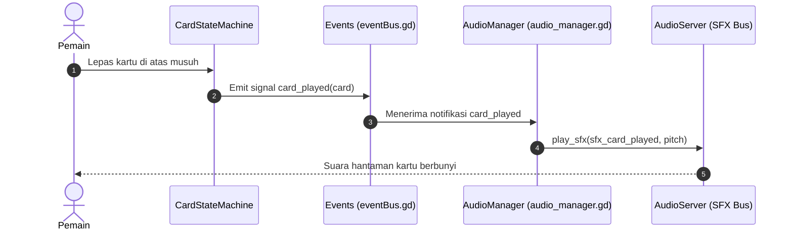

# Panduan Integrasi Audio & Matriks Suara (Audio Integration Guide)
### Proyek: ALTAR-52 (Godot 4)

Dokumen ini ditujukan untuk **Sound Designer** dan programmer yang menangani audio. Panduan ini menjelaskan bagaimana arsitektur audio dirancang, peta titik pemicu suara (Audio Cue Map), dan cara termudah mengintegrasikan SFX & BGM ke dalam game tanpa merusak script gameplay.

---

## 1. Arsitektur Audio Terpusat (Event-Driven Audio)

Di ALTAR-52, kita **sangat menghindari** meletakkan node `AudioStreamPlayer` secara sembarangan di dalam script logika seperti `enemy.gd`, `damageEffect.gd`, atau `cardReleasedState.gd`. 

### Mengapa?
1. Mencegah tim audio dan gameplay programmer saling bentrok (*merge conflict*) di Git.
2. Memudahkan penggantian, penyeimbangan volume (*mixing*), dan pengujian aset audio di satu tempat terpusat.
3. Menjamin audio tetap terkelola dengan baik bahkan ketika sebuah node kartu atau musuh dihapus dari memori (`queue_free()`).

### Alur Kerja Audio:


---

## 2. Setup Audio Bus di Godot Editor

Pastikan proyek memiliki 4 bus audio standar di tab **Audio** (bawah editor Godot):

```text
Master (0 dB)
 ├── BGM (-6 dB)  --> Routing ke Master
 ├── SFX (0 dB)   --> Routing ke Master
 └── UI (-2 dB)   --> Routing ke Master
```

* **Master**: Saluran utama audio game.
* **BGM**: Musik latar eksplorasi dan pertempuran (mendukung crossfade transisi).
* **SFX**: Seluruh efek suara pertempuran, kartu, benturan perisai, dan serangan monster.
* **UI**: Efek klik tombol, popup modal, dan navigasi menu.

---

## 3. Matriks Pemicu Suara (Master Audio Trigger Map)

Tabel berikut adalah katalog lengkap semua aksi dalam game yang membutuhkan efek suara, lokasi script-nya, serta cara pemicuannya:

### A. Interaksi Kartu & Tangan Pemain

| Sound ID | Deskripsi Aksi | Lokasi Script & Titik Pemicu | Sinyal / Hook | Bus | Karakteristik Audio |
| :--- | :--- | :--- | :--- | :--- | :--- |
| `SFX_CARD_HOVER` | Mouse melayang di atas kartu | [`cardHoverState.gd`](../Script/Card/Card_State/cardHoverState.gd) (`enter()`) | `Events.card_hovered` | `SFX` | *Short subtle swoosh / card lift* (< 0.15s) |
| `SFX_CARD_CLICK` | Kartu ditekan (klik kiri) | [`cardClickedState.gd`](../Script/Card/Card_State/cardClickedState.gd) (`enter()`) | `CardClickedState` | `SFX` | *Crisp click / pickup sound* (< 0.1s) |
| `SFX_CARD_DRAG` | Kartu mulai diseret melayang | [`cardDraggingState.gd`](../Script/Card/Card_State/cardDraggingState.gd) (`enter()`) | `Events.card_drag_started` | `SFX` | *Air whoosh / card gliding* (< 0.2s) |
| `SFX_CARD_CANCEL` | Tarikan dibatalkan (klik kanan / drop salah) | [`cardDraggingState.gd`](../Script/Card/Card_State/cardDraggingState.gd) / `cardReleasedState.gd` | `Events.card_drag_ended` | `SFX` | *Soft snap back to hand* (< 0.15s) |
| `SFX_CARD_AIM` | Mulai membidik musuh (garis panah muncul) | [`CardTargetSelector.gd`](../Script/Card/CardTargetSelector.gd) (`_on_card_aim_started`) | `Events.card_aim_started` | `SFX` | *Tension pull / magic hum* |
| `SFX_CARD_PLAY` | Kartu sukses dimainkan ke arena | [`cardReleasedState.gd`](../Script/Card/Card_State/cardReleasedState.gd) (`_evaluate_release`) | `Events.card_played` | `SFX` | *Card impact slam / energy release* |
| `SFX_CARD_EXHAUST` | Kartu hangus / hilang permanen | [`cardReleasedState.gd`](../Script/Card/Card_State/cardReleasedState.gd) (blok `exhaust`) | Logika exhaust | `SFX` | *Fire burn / ash dissolve* (< 0.5s) |
| `SFX_DECK_DRAW` | Kartu ditarik dari draw pile ke tangan | [`playerHandler.gd`](../Script/Combat/playerHandler.gd) (`draw_card()`) | Internal timer Tween | `SFX` | *Fast card flick / deck slide* (< 0.12s) |
| `SFX_DECK_DISCARD`| Kartu dibuang di akhir giliran | [`playerHandler.gd`](../Script/Combat/playerHandler.gd) (`discard_cards()`) | `Events.player_hand_discarded` | `SFX` | *Card sweep to discard pile* |
| `SFX_DECK_SHUFFLE`| Tumpukan buangan dikocok ulang ke deck | [`playerHandler.gd`](../Script/Combat/playerHandler.gd) (`reshuffle_deck_from_discard()`) | Saat draw pile kosong | `SFX` | *Riffle shuffle / card flutter* (< 0.8s) |

---

### B. Pertempuran (Combat & Damage)

| Sound ID | Deskripsi Aksi | Lokasi Script & Titik Pemicu | Sinyal / Hook | Bus | Karakteristik Audio |
| :--- | :--- | :--- | :--- | :--- | :--- |
| `SFX_ATTACK_SLASH` | Serangan tebasan senjata kartu | [`damageEffect.gd`](../Script/Card/Effect/damageEffect.gd) (`execute()`) | Saat target `take_damage()` | `SFX` | *Sharp metal sword slash* |
| `SFX_ATTACK_PUNCH` | Serangan tinju (BareHand) | [`damageEffect.gd`](../Script/Card/Effect/damageEffect.gd) | Dipilih berdasarkan data kartu | `SFX` | *Heavy blunt punch impact* |
| `SFX_HURT_ENEMY` | Musuh menerima luka fisik | [`enemy.gd`](../Script/Entity/Enemy/enemy.gd) (`take_damage()`) | Panggilan fungsi `take_damage` | `SFX` | *Monster pain grunt / bone strike* |
| `SFX_ENEMY_ATTACK` | Musuh menerjang maju menyerang | [`enemy_attack.gd`](../Script/Entity/Enemy/Action/enemy_attack.gd) (`perform_action()`) | Tween animasi serang musuh | `SFX` | *Monster growl + claw slash* |
| `SFX_HURT_PLAYER` | Karakter pemain terkena damage | [`playerHandler.gd`](../Script/Combat/playerHandler.gd) (`take_damage()`) | Pengurangan HP player | `SFX` | *Heavy body impact / breath knock* |
| `SFX_SHIELD_GAIN` | Player / musuh menambah nilai armor | [`blockEffect.gd`](../Script/Card/Effect/blockEffect.gd) & [`enemy.gd`](../Script/Entity/Enemy/enemy.gd) (`add_block`) | Penambahan nilai block | `SFX` | *Shield up / metal clang buff* |
| `SFX_SHIELD_HIT` | Serangan tertahan oleh Block/Armor | [`stats.gd`](../Script/Entity/Stats/stats.gd) (`take_damage()`) | Saat `damage_mitigated > 0` | `SFX` | *Metallic armor deflection clink* |
| `SFX_BUFF_APPLIED` | Efek kekuatan bertambah (Strength) | [`strenghtEffect.gd`](../Script/Card/Effect/strenghtEffect.gd) (`execute()`) | Eksekusi buff | `SFX` | *Aura surge / power chime* |
| `SFX_DEBUFF_APPLIED`| Efek kelemahan diterapkan (Weakened)| [`weakendEffect.gd`](../Script/Card/Effect/weakendEffect.gd) (`execute()`) | Eksekusi debuff | `SFX` | *Dark curse / draining whisper* |
| `SFX_ENEMY_DEAD` | Musuh tewas (HP = 0) | [`enemy.gd`](../Script/Entity/Enemy/enemy.gd) (`take_damage()`) | Sinyal `Enemy.died` | `SFX` | *Monster death roar / collapse* |
| `SFX_TURN_PLAYER` | Giliran pemain dimulai | [`combat.gd`](../Script/Combat/combat.gd) (`_start_player_turn()`) | `Events.player_turn_started` | `SFX` | *Heroic turn bell / light whoosh* |
| `SFX_TURN_ENEMY` | Giliran musuh dimulai | [`EnemyHandler.gd`](../Script/Combat/EnemyHandler.gd) (`start_enemy_turn()`) | `Events.enemy_turn_started` | `SFX` | *Ominous gong / monster turn cue* |
| `SFX_VICTORY` | Seluruh musuh kalah (Kemenangan) | [`combat.gd`](../Script/Combat/combat.gd) (`_on_victory()`) | `Events.combat_victory` | `SFX` | *Triumphant victory fanfare* (< 3s) |
| `SFX_DEFEAT` | Pemain mati (Kekalahan) | [`combat.gd`](../Script/Combat/combat.gd) (`_on_player_stats_changed()`) | `Events.player_died` | `SFX` | *Dark defeat drone / sting* |

---

### C. Eksplorasi Dungeon & Antarmuka UI

| Sound ID | Deskripsi Aksi | Lokasi Script & Titik Pemicu | Sinyal / Hook | Bus | Karakteristik Audio |
| :--- | :--- | :--- | :--- | :--- | :--- |
| `SFX_DOOR_CLICK` | Pemain mengklik pintu dungeon | [`door.gd`](../Script/Exploration/door.gd) (`_on_gui_input()`) | `Door.door_selected` | `SFX` | *Heavy stone dungeon door opening* |
| `SFX_ALTAR_USE` | Pemain mengaktifkan altar | [`altar.gd`](../Script/Exploration/Room/altar.gd) (`_on_gui_input()`) | `Altar.altar_used` | `SFX` | *Ethereal magical chime / altar hum* |
| `SFX_BTN_END_TURN` | Tombol End Turn ditekan | [`battle_ui.gd`](../Script/UI/battle_ui.gd) (`_on_end_turn_button_pressed`) | `Events.ui_button_clicked` | `UI` | *Crisp wooden / mechanical button click* |
| `SFX_PROMPT_YES` | Konfirmasi Yes pada dialog | [`prompt_panel_ui.gd`](../Script/UI/prompt_panel_ui.gd) (`_on_btn_yes_pressed`) | `Events.ui_button_clicked` | `UI` | *Positive confirmation pop* |
| `SFX_PROMPT_NO` | Konfirmasi No pada dialog | [`prompt_panel_ui.gd`](../Script/UI/prompt_panel_ui.gd) (`_on_btn_no_pressed`) | `Events.ui_button_clicked` | `UI` | *Neutral cancel pop* |
| `BGM_COMBAT` | Musik latar pertempuran | [`combat.gd`](../Script/Combat/combat.gd) (`_ready()`) | Inisialisasi Combat | `BGM` | *Looping intense battle track* |
| `BGM_DUNGEON` | Musik latar lorong dungeon | [`game_manager.gd`](../Script/Game_System/game_manager.gd) (`return_to_dungeon_overworld()`) | Transisi ke explore.tscn | `BGM` | *Atmospheric ambient dungeon track* |

---

## 4. Cara Mengintegrasikan Audio Baru (Panduan Praktis)

### Langkah 1: Pasang File Audio di Folder Proyek
1. Simpan file audio mentah di dalam folder:
   * Efek suara: `Resources/Audio/SFX/`
   * Musik: `Resources/Audio/BGM/`
2. Disarankan format:
   * **SFX**: `.wav` (uncompressed, latensi terendah) atau `.ogg` (untuk file panjang).
   * **BGM**: `.ogg` (kompresi hemat memori dengan loop points).

### Langkah 2: Hubungkan ke Inspector `AudioManager` (Tanpa Koding!)
1. Buka scene atau node `AudioManager` di Godot Editor.
2. Pada panel **Inspector**, lihat grup **Card Audio Cues**, **Combat Audio Cues**, atau **UI Audio Cues**.
3. Tarik (*drag-and-drop*) file `.wav` / `.ogg` Anda ke slot variabel yang sesuai (misal: `sfx_card_played`).
4. Jalankan game — suara akan otomatis berbunyi ketika event tersebut terjadi di dalam game!

### Langkah 3: Menambahkan Variasi Nada (Game Feel / Anti-Repetitive)
Jika memanggil SFX secara kustom melalui kode, selalu gunakan sedikit modulasi nada (pitch variation) agar telinga pemain tidak lelah:

```gdscript
# Variasikan pitch antara 0.95 (sedikit berat) hingga 1.05 (sedikit ringan)
AudioManager.play_sfx(sfx_card_hover, randf_range(0.95, 1.05))
```
