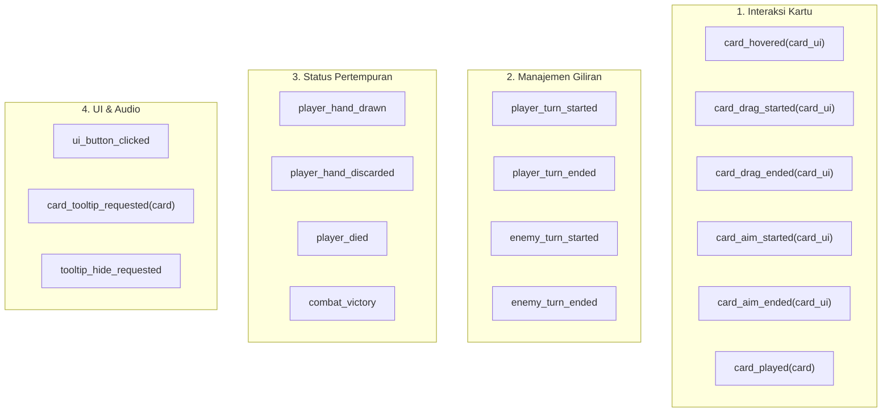

# Katalog Sinyal Global (EventBus Reference)
### Proyek: ALTAR-52 (Godot 4)
### Autoload Singleton: `Events` (`res://Script/Game_System/eventBus.gd`)

Dokumen ini adalah kamus rujukan lengkap untuk seluruh sinyal global yang tersedia di stasiun radio sentral `Events`. Seluruh sistem (UI, Combat, Card FSM, dan Audio) berkomunikasi melalui sinyal-sinyal berikut.

---

## 1. Ikhtisar Sinyal



---

## 2. Kamus Detail Sinyal

### A. Interaksi Kartu & Input

#### 1. `card_hovered(card_ui: CardUI)`
* **Deskripsi**: Dipancarkan saat kursor mouse memasuki batas visual kartu di tangan.
* **Payload**: `card_ui` (`CardUI`) — Referensi komponen UI kartu yang sedang di-hover.
* **Pemancar (Emitter)**: [`cardHoverState.gd`](../Script/Card/Card_State/cardHoverState.gd) (`enter()`).
* **Penerima (Listener)**: [`AudioManager`](../Script/Game_System/audio_manager.gd) (memutar suara `sfx_card_hover`).

#### 2. `card_drag_started(card_ui: CardUI)`
* **Deskripsi**: Dipancarkan saat pemain mulai menarik kartu dari tangan ke area permainan.
* **Payload**: `card_ui` (`CardUI`) — Referensi komponen UI kartu yang sedang ditarik.
* **Pemancar (Emitter)**: [`cardDraggingState.gd`](../Script/Card/Card_State/cardDraggingState.gd) (`enter()`).
* **Penerima (Listener)**: 
  * [`hand.gd`](../Script/Combat/hand.gd) (mengisolasi kartu lain agar tidak merespons mouse hover).
  * [`AudioManager`](../Script/Game_System/audio_manager.gd) (memutar suara `sfx_card_drag_start`).

#### 3. `card_drag_ended(card_ui: CardUI)`
* **Deskripsi**: Dipancarkan saat kartu selesai diseret, baik karena dilepas ke arena maupun dibatalkan.
* **Payload**: `card_ui` (`CardUI`) — Referensi komponen UI kartu.
* **Pemancar (Emitter)**: [`cardDraggingState.gd`](../Script/Card/Card_State/cardDraggingState.gd) (`exit()`).
* **Penerima (Listener)**: 
  * [`hand.gd`](../Script/Combat/hand.gd) (memulihkan interaktivitas hover semua kartu di tangan).
  * [`AudioManager`](../Script/Game_System/audio_manager.gd) (memutar suara pembatalan tarikan).

#### 4. `card_aim_started(card_ui: CardUI)`
* **Deskripsi**: Dipancarkan saat kartu dengan penargetan spesifik (`SINGLE_ENEMY`) ditarik melewati ambang batas bidik.
* **Payload**: `card_ui` (`CardUI`) — Komponen kartu yang membidik.
* **Pemancar (Emitter)**: Card Aiming State / Selector logic.
* **Penerima (Listener)**: [`CardTargetSelector.gd`](../Script/Card/CardTargetSelector.gd) (memunculkan garis bidik `Line2D` dan mengaktifkan detektor musuh).

#### 5. `card_aim_ended(card_ui: CardUI)`
* **Deskripsi**: Dipancarkan saat pembidikan musuh selesai atau dibatalkan.
* **Payload**: `card_ui` (`CardUI`).
* **Penerima (Listener)**: [`CardTargetSelector.gd`](../Script/Card/CardTargetSelector.gd) (menyembunyikan garis panah bidik).

#### 6. `card_played(card: Card)`
* **Deskripsi**: Dipancarkan setelah kartu valid dieksekusi di arena permainan.
* **Payload**: `card` (`Card`) — Resource data kartu yang berhasil dimainkan.
* **Pemancar (Emitter)**: [`cardReleasedState.gd`](../Script/Card/Card_State/cardReleasedState.gd) (`_evaluate_release()`).
* **Penerima (Listener)**: 
  * [`playerHandler.gd`](../Script/Combat/playerHandler.gd) (memasukkan kartu ke dalam `discard_pile`).
  * [`hand.gd`](../Script/Combat/hand.gd) (menambah penghitung `cards_played_this_turn`).
  * [`AudioManager`](../Script/Game_System/audio_manager.gd) (memutar suara hantaman kartu).

---

### B. Siklus Giliran & Pertempuran

#### 7. `player_turn_started`
* **Deskripsi**: Dipancarkan saat giliran bertindak kembali ke tangan pemain.
* **Payload**: Tidak ada.
* **Pemancar (Emitter)**: [`combat.gd`](../Script/Combat/combat.gd) (`_start_player_turn()`).
* **Penerima (Listener)**: 
  * [`battle_ui.gd`](../Script/UI/battle_ui.gd) (mengaktifkan kembali tombol End Turn).
  * [`AudioManager`](../Script/Game_System/audio_manager.gd) (memutar efek suara giliran pemain).

#### 8. `player_turn_ended`
* **Deskripsi**: Dipancarkan saat pemain menekan tombol mengakhiri giliran.
* **Payload**: Tidak ada.
* **Pemancar (Emitter)**: [`battle_ui.gd`](../Script/UI/battle_ui.gd) (`_on_end_turn_button_pressed()`).
* **Penerima (Listener)**: [`PlayerHandler`](../Script/Combat/playerHandler.gd) (memulai fase pembuangan sisa kartu tangan).

#### 9. `player_hand_drawn`
* **Deskripsi**: Dipancarkan setelah seluruh kartu giliran selesai ditarik ke tangan pemain dengan jeda Tween.
* **Payload**: Tidak ada.
* **Pemancar (Emitter)**: [`playerHandler.gd`](../Script/Combat/playerHandler.gd) (`draw_cards()`).
* **Penerima (Listener)**: Handler giliran atau efek awal turn pemain.

#### 10. `player_hand_discarded`
* **Deskripsi**: Dipancarkan setelah semua sisa kartu tangan pemain selesai dibuang ke tumpukan buang.
* **Payload**: Tidak ada.
* **Pemancar (Emitter)**: [`playerHandler.gd`](../Script/Combat/playerHandler.gd) (`discard_cards()`).
* **Penerima (Listener)**: [`combat.gd`](../Script/Combat/combat.gd) -> Memicu `EnemyHandler.start_enemy_turn()`.

#### 11. `enemy_turn_started`
* **Deskripsi**: Dipancarkan saat musuh memulai urutan serangannya.
* **Payload**: Tidak ada.
* **Pemancar (Emitter)**: [`EnemyHandler.gd`](../Script/Combat/EnemyHandler.gd).
* **Penerima (Listener)**: [`AudioManager`](../Script/Game_System/audio_manager.gd) & Battle HUD.

#### 12. `enemy_turn_ended`
* **Deskripsi**: Dipancarkan setelah semua musuh selesai menyerang dan bersiap kembali ke giliran pemain.
* **Payload**: Tidak ada.
* **Pemancar (Emitter)**: [`EnemyHandler.gd`](../Script/Combat/EnemyHandler.gd).
* **Penerima (Listener)**: [`combat.gd`](../Script/Combat/combat.gd) (memulai giliran baru pemain).

---

### C. Kondisi Menang & Kalah

#### 13. `combat_victory`
* **Deskripsi**: Dipancarkan saat seluruh musuh dalam arena berhasil dikalahkan.
* **Payload**: Tidak ada.
* **Pemancar (Emitter)**: [`combat.gd`](../Script/Combat/combat.gd) (`_on_victory()`).
* **Penerima (Listener)**: [`AudioManager`](../Script/Game_System/audio_manager.gd) (memutar fanfare kemenangan).

#### 14. `player_died`
* **Deskripsi**: Dipancarkan saat HP pemain mencapai 0 (Game Over).
* **Payload**: Tidak ada.
* **Pemancar (Emitter)**: [`combat.gd`](../Script/Combat/combat.gd) & [`playerHandler.gd`](../Script/Combat/playerHandler.gd).
* **Penerima (Listener)**: [`AudioManager`](../Script/Game_System/audio_manager.gd) (memutar suara kekalahan) & Screen Game Over.

---

### D. Umpan Balik Antarmuka (UI Feedback)

#### 15. `ui_button_clicked`
* **Deskripsi**: Sinyal generik setiap kali ada tombol UI penting yang ditekan.
* **Payload**: Tidak ada.
* **Pemancar (Emitter)**: [`battle_ui.gd`](../Script/UI/battle_ui.gd), [`prompt_panel_ui.gd`](../Script/UI/prompt_panel_ui.gd), [`forfeit_button.gd`](../Script/Exploration/Room/forfeit_button.gd).
* **Penerima (Listener)**: [`AudioManager`](../Script/Game_System/audio_manager.gd) (memutar suara klik tombol universal).

---

## 3. Pedoman Menambahkan Sinyal Baru

Saat menambahkan sinyal baru ke [`eventBus.gd`](../Script/Game_System/eventBus.gd):
1. **Gunakan Penamaan Past-Tense**: Gunakan bentuk masa lampau (contoh: `card_selected`, bukan `select_card`).
2. **Definisikan Tipe Parameter Statis**: Selalu tuliskan tipe data secara eksplisit:
   ```gdscript
   signal relic_collected(relic_data: RelicData)
   ```
3. **Sertakan Docstring `##`**: Berikan penjelasan fungsi sinyal agar otomatis muncul di menu bantuan editor Godot (**F1**).
