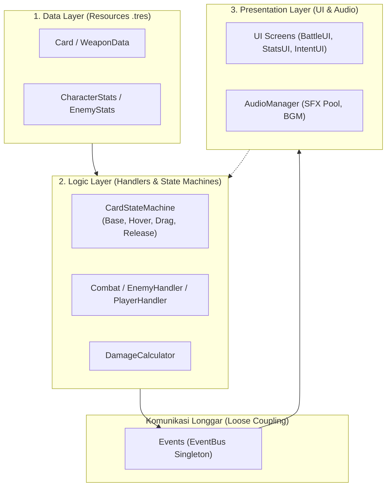

# ALTAR-52 — Codebase Onboarding & Architecture Guide

Selamat datang di proyek **ALTAR-52**! Dokumen ini disusun sebagai gerbang utama bagi anggota tim pengembang baru—khususnya **UI Programmer** dan **Sound Designer**—agar dapat memahami struktur proyek, arsitektur sistem, dan alur kerja integrasi dengan cepat dan teratur.

---

## 1. Ikhtisar Proyek & Spesifikasi Engine

* **Engine Target**: Godot Engine **4.x** (Fitur 4.7, Renderer: `GL Compatibility` / `Mobile friendly`)
* **Bahasa**: GDScript (Menerapkan Static Typing & Godot 4 Native Docstrings `##`)
* **Resolusi Viewport**: `1920 x 1080` (Mode Stretch: `canvas_items`)
* **Autoload Global (Singletons)**:
  1. `GameManager` (`res://Script/Game_System/game_manager.gd`): Mengatur status global run (floor, HP overworld, transisi antar ruangan).
  2. `Events` (`res://Script/Game_System/eventBus.gd`): EventBus pusat komunikasi publish-subscribe antar-sistem.
  3. `PlayerHandler` (`res://Scene/playerHandler.tscn`): Mengontrol tumpukan kartu (Draw, Discard), giliran pemain, dan kalkulasi damage masuk.
  4. *(Opsional/Terjadwal)* `AudioManager` (`res://Script/Game_System/audio_manager.gd`): Singleton pengelola pemutaran SFX, BGM, dan respon audio EventBus.

---

## 2. Struktur Direktori Proyek

```text
├── Data/                   # Godot Custom Resources (.tres)
│   ├── Room/               # Konfigurasi data ruangan (club, diamond, heart, spade)
│   ├── Stats/              # Resource default CharacterStats & EnemyStats
│   └── Weapon/             # Resource kartu, dek, dan senjata (BareHand, GuardSword)
├── docs/                   # PUSAT DOKUMENTASI & ONBOARDING
│   ├── README.md           # Master Onboarding (Dokumen ini)
│   ├── AUDIO_INTEGRATION_GUIDE.md # Panduan & Matriks Suara untuk Sound Designer
│   ├── UI_ARCHITECTURE.md  # Panduan Arsitektur & Hierarki untuk UI Programmer
│   └── EVENT_BUS_CATALOG.md# Katalog Sinyal Global & Parameter Payload
├── Resources/              # Aset visual mentah (Texture, Icon, Sprite)
├── Scene/                  # Scene (.tscn)
│   ├── Components/         # Sub-scene modular (Card, Door, Skeleton, dll.)
│   ├── combat.tscn         # Scene pertempuran turn-based
│   └── explore.tscn        # Scene pemilihan pintu dungeon
└── Script/                 # Sumber kode GDScript
    ├── Card/               # CardUI, CardStateMachine, dan Effect kartu
    ├── Combat/             # Combat manager, Hand, PlayerHandler, DamageCalculator
    ├── Entity/             # Enemy controller, AI picker, dan Stats resource
    ├── Exploration/        # Door, DungeonManager, Altar, Room
    ├── Game_System/        # EventBus, GameManager, AudioManager
    ├── Inventory/          # ItemData, WeaponData, InventoryData
    └── UI/                 # BattleUI, StatsUI, IntentUI, CardPileUI, PromptPanel
```

---

## 3. Arsitektur Inti: 3 Pilar Utama ALTAR-52



1. **Resource-Driven Architecture**:
   Logika pertempuran, kartu, dan musuh tidak di-*hardcode* di dalam script node, melainkan dikemas dalam Godot `Resource` (`Card`, `Stats`, `WeaponData`). UI dan Gameplay membaca data dari Resource ini.
2. **Event-Driven via EventBus (`Events`)**:
   Sistem tidak saling memanggil secara langsung (misal: UI tidak memanggil langsung node Combat). Node memancarkan sinyal ke `Events`, dan node yang berkepentingan akan mendengarkannya.
3. **Pemisahan Tampilan (View) dan Model (Data)**:
   Komponen visual (seperti `CardUI` dan `StatsUI`) murni bertindak sebagai penampil dan penerima input interaksi, mendelegasikan pemrosesan ke FSM atau data resource.

---

## 4. Panduan Khusus per Peran (Role Guides)

### A. Untuk Sound Designer
* Baca panduan lengkap di: [`docs/AUDIO_INTEGRATION_GUIDE.md`](./AUDIO_INTEGRATION_GUIDE.md).
* **Aturan Emas**: Jangan menyisipkan kode audio manual di dalam script pertempuran atau FSM kartu jika tidak mendesak! Gunakan singleton [`AudioManager.gd`](../Script/Game_System/audio_manager.gd) yang secara otomatis menangkap sinyal dari [`eventBus.gd`](../Script/Game_System/eventBus.gd).
* Gunakan Audio Bus Godot (`Master`, `BGM`, `SFX`, `UI`) untuk kontrol mixing volume yang seimbang.

### B. Untuk UI Programmer
* Baca panduan lengkap di: [`docs/UI_ARCHITECTURE.md`](./UI_ARCHITECTURE.md).
* Bedakan antara **Screen HUD** (misal [`battle_ui.gd`](../Script/UI/battle_ui.gd)), **Reusable Components** (misal [`stats_ui.gd`](../Script/UI/stats_ui.gd)), dan **Gameplay Interactive UI** (misal [`CardUI.gd`](../Script/Card/CardUI.gd) & [`hand.gd`](../Script/Combat/hand.gd)).
* Manfaatkan fitur **Search Help (F1)** di Godot Editor untuk melihat dokumentasi API tiap kelas yang sudah dilengkapi docstring `##`.

---

## 5. Konvensi Kode & Kontribusi Git

1. **Penamaan Berkas & Kelas**:
   * Nama script class PascalCase (`class_name CardUI`).
   * Nama file snake_case (`stats_ui.gd`, `battle_ui.gd`).
   * Nama sinyal snake_case past-tense (`card_played`, `player_died`).
2. **Static Typing Godot 4**:
   * Selalu gunakan pengetikan statis pada parameter dan kembalian fungsi:
     ```gdscript
     func update_hud(new_stats: Stats) -> void:
     ```
3. **Dokumentasi GDScript (`##`)**:
   * Tuliskan penjelasan `##` sebelum deklarasi `class_name`, `signal`, `@export var`, dan fungsi publik agar dapat dibaca otomatis di Godot Engine Help (`F1`).
