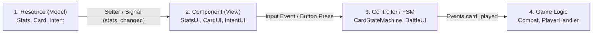
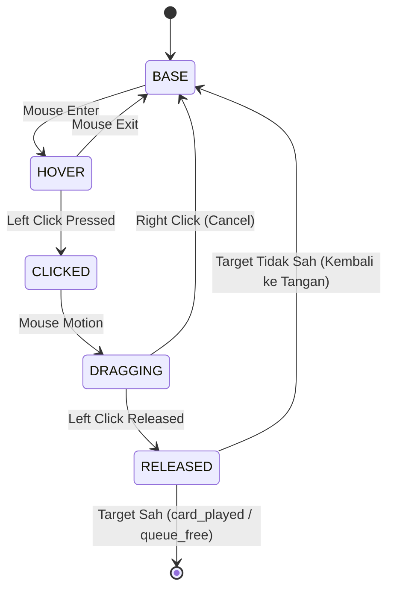

# Panduan Arsitektur & Hierarki UI (UI Architecture Guide)
### Proyek: ALTAR-52 (Godot 4)

Dokumen ini disusun khusus untuk **UI Programmer** yang bertugas memelihara, mempercantik, atau menambahkan antarmuka pengguna di dalam proyek ALTAR-52.

---

## 1. Filosofi Utama Desain UI

Arsitektur UI di ALTAR-52 berpegang pada 3 prinsip utama:



1. **Data-Driven (Resource -> View)**:
   Komponen UI tidak boleh memiliki variabel internal untuk "menyimpan" HP atau Block pemain. Komponen UI hanya menerima objek `Resource` (seperti `CharacterStats` atau `Card`), lalu mengikat sinyal perubahan data tersebut ke fungsi pembaruan visual.
2. **Pemisahan Screen vs Reusable Component**:
   Layar besar (seperti `BattleUI`) tersusun dari komponen-komponen kecil yang dapat digunakan kembali (`StatsUI`, `CardPileUI`). Komponen kecil ini tidak tahu tentang konteks layar induknya.
3. **Komunikasi Bebas Dependensi (EventBus)**:
   Tombol dan interaksi pengguna tidak memanggil sistem tempur secara langsung. UI cukup memancarkan sinyal global melalui singleton `Events` (misal: `Events.player_turn_ended.emit()`).

---

## 2. Katalog Komponen di `Script/UI/`

### A. `BattleUI` (`CanvasLayer`)
* **File**: [`Script/UI/battle_ui.gd`](../Script/UI/battle_ui.gd)
* **Peran**: Pengendali utama seluruh antarmuka saat fase pertempuran berlangsung.
* **Elemen Child Utama**:
  * `$TurnLabel` (`Label`): Menampilkan teks pergantian giliran dengan animasi fade-in / fade-out via Tween.
  * `$PlayerStatsUI` (`StatsUI`): Menampilkan bar HP dan perisai Block milik pemain.
  * `$EndTurnButton` (`Button`): Tombol akhir giliran. Otomatis *disabled* saat giliran musuh untuk mencegah spam klik.
* **Metode Kunci**:
  * `initialize_player(character_stats: CharacterStats)`: Menyuntikkan resource statistik pemain ke dalam `player_stats_ui`.
  * `show_turn_banner(text: String)`: Menjalankan animasi banner giliran ("PLAYER TURN" / "ENEMY TURN").

---

### B. `StatsUI` (`Control`) — Komponen Generik Reusable
* **File**: [`Script/UI/stats_ui.gd`](../Script/UI/stats_ui.gd)
* **Peran**: Komponen serbaguna untuk menampilkan bar darah (`HPBar`) dan angka pertahanan (`BlockLabel`).
* **Penggunaan Ganda**:
  1. Digunakan di HUD Pemain di dalam `BattleUI`.
  2. Digunakan di atas kepala setiap entitas musuh (`Enemy` scene memiliki node `$StatsUI`).
* **Cara Kerja**:
  Menggunakan setter GDScript:
  ```gdscript
  var stats: Stats : set = set_stats
  ```
  Setiap kali property `stats` diisi, skrip otomatis melepaskan koneksi sinyal lama dan menghubungkan sinyal `stats_changed` yang baru ke fungsi `update_hud()`.

---

### C. `IntentUI` (`HBoxContainer`)
* **File**: [`Script/UI/intent_ui.gd`](../Script/UI/intent_ui.gd)
* **Peran**: Menampilkan rencana aksi musuh (telegraph) sebelum musuh bertindak.
* **Elemen Child**:
  * `$Icon` (`TextureRect`): Ikon pedang (Attack), perisai (Block), atau buff.
  * `$Number` (`Label`): Nilai prediksi damage atau block yang akan dihasilkan.
* **Metode Kunci**:
  * `update_intent(intent_data: Intent)`: Menerima resource `Intent` dan memperbarui ikon serta teks angka. Jika teks angka kosong (misal aksi buff), label angka otomatis disembunyikan.

---

### D. `CardPileUI` (`Label`)
* **File**: [`Script/UI/card_pile_label.gd`](../Script/UI/card_pile_label.gd)
* **Peran**: Label reaktif yang menampilkan sisa kartu di tumpukan tarik (*Draw Pile*) atau tumpukan buang (*Discard Pile*).
* **Cara Kerja**:
  Menerima referensi objek `CardPile` melalui `set_target_pile()`, lalu mendengarkan sinyal `target_pile.pile_size_changed` untuk memperbarui format teks secara real-time.

---

### E. `PromptPanel` (`Panel`)
* **File**: [`Script/UI/prompt_panel_ui.gd`](../Script/UI/prompt_panel_ui.gd)
* **Peran**: Jendela dialog modal untuk meminta konfirmasi pemain (Yes / No).
* **Sinyal**:
  * `yes_confirmation(payload)`: Terpancar bersama data payload saat pemain menekan tombol Ya.
  * `no_confirmation`: Terpancar saat pemain menekan Tidak.

---

## 3. Sistem Antarmuka Kartu (Gameplay UI)

Sistem kartu berada di luar folder `Script/UI/` karena memiliki interaktivitas tinggi dengan fisika dan logika tempur.



### A. `CardUI` (`Control`)
* **File**: [`Script/Card/CardUI.gd`](../Script/Card/CardUI.gd)
* **Anatomi Node**:
  * `$CostLabel`: Menampilkan konsumsi mana kartu.
  * `$NameLabel`: Nama kartu.
  * `$DescriptionLabel` (`RichTextLabel`): Efek deskripsi kartu.
  * `$IconRect`: Ilustrasi visual kartu.
  * `$DropPointDetector` (`Area2D`): Radar untuk mendeteksi apakah kartu berada di atas drop area atau musuh.
  * `$CardStateMachine`: Pengendali state interaksi kartu.

### B. Siklus State Machine Kartu (`CardStateMachine`)
Semua logika interaksi kursor dipecah ke dalam script terpisah di `Script/Card/Card_State/`:
1. **`CardBaseState`**: Kondisi kartu diam di dalam kontainer tangan. Mereset posisi Y dan rotasi ke default.
2. **`CardHoverState`**: Mengangkat kartu ke atas (`position:y = -120px`), membesarkan skala (`1.2x`), dan memancarkan `Events.card_hovered`.
3. **`CardClickedState`**: Merekam offset titik klik kursor dan mengaktifkan monitoring `DropPointDetector`.
4. **`CardDraggingState`**: Mereparent kartu ke layer UI teratas agar melayang bebas di atas semua elemen layar, memperbarui posisi mengikuti kursor mouse, dan memancarkan `Events.card_drag_started`.
5. **`CardReleasedState`**: Mengevaluasi apakah area drop valid sesuai enum target kartu (`SELF`, `SINGLE_ENEMY`, `ALL_ENEMIES`). Jika valid, efek kartu dieksekusi dan kartu dihapus (`queue_free()`). Jika tidak valid, kartu dikembalikan ke tangan pemain via `card_ui.reparent_requested`.

### C. `Hand` (`HBoxContainer`)
* **File**: [`Script/Combat/hand.gd`](../Script/Combat/hand.gd)
* **Peran**: Kontainer tata letak kartu pemain.
* **Mekanisme Krusial**:
  * `add_card_to_hand(card_data: Card)`: Menginstansiasi scene `CardUI.tscn`, menyuntikkan data resource `Card`, dan menghubungkan sinyal reparenting.
  * **Hover Isolation**: Saat ada satu kartu yang masuk ke status dragging, `Hand` otomatis menyetel `mouse_filter = Control.MOUSE_FILTER_IGNORE` pada semua kartu lainnya agar tidak terjadi glitch perebutan fokus kursor.

---

## 4. Panduan Menambahkan Komponen UI Baru

Jika Anda ingin menambahkan komponen UI baru (contoh: bar Relic atau indikator Mana):

### Langkah 1: Buat Scene Komponen Baru
1. Buat node dasar bertipe `Control` atau turunannya (misal `HBoxContainer`).
2. Buat script dengan nama PascalCase dan berikan `class_name` (contoh: `class_name ManaUI`).
3. Berikan docstring standar Godot 4 `##` di bagian atas script.

### Langkah 2: Terapkan Pola Reaktif (Data Binding)
Hubungkan komponen UI Anda dengan mendengarkan `Events`:
```gdscript
## Komponen HUD penampil jumlah Mana pemain.
class_name ManaUI
extends HBoxContainer

@onready var mana_label: Label = $ManaLabel

func _ready() -> void:
    # Dengarkan sinyal dari stasiun pusat EventBus
    Events.player_mana_changed.connect(_on_mana_changed)

func _on_mana_changed(new_mana: int) -> void:
    mana_label.text = "%d" % new_mana
```

### Langkah 3: Tempelkan ke Scene `combat.tscn`
1. Buka `Scene/combat.tscn`.
2. Masukkan instansiasi scene komponen Anda di bawah node `$BattleUI`.
3. Atur Anchor Presets pada editor 2D (misal: Bottom-Left atau Top-Right) dengan ukuran resolusi basis `1920x1080`.
